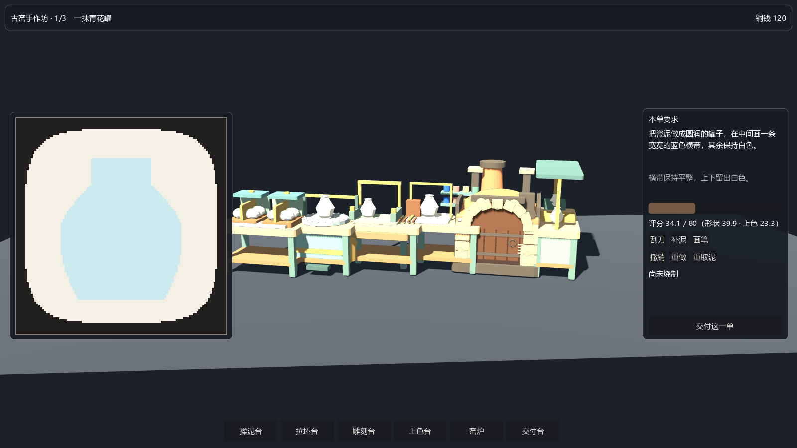
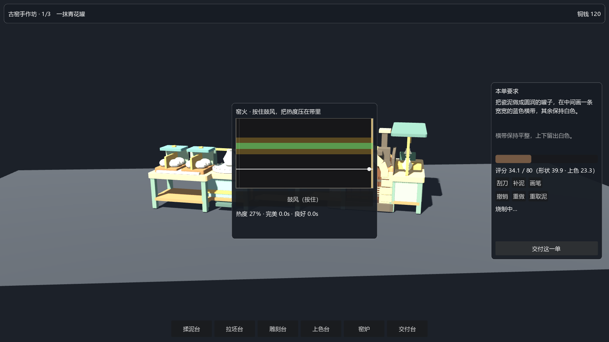
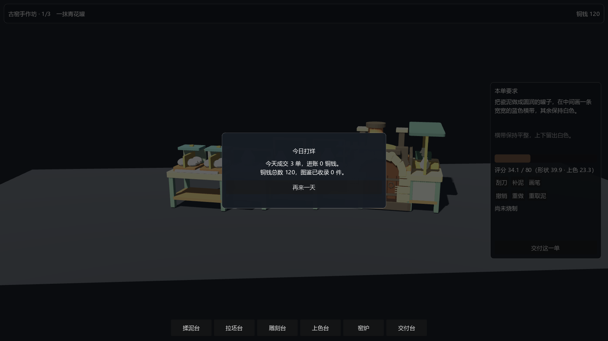

# 开窑啦！Kiln Day

景德镇陶瓷题材的小游戏：捏器型、描纹样、看窑火。Godot 4.7 工程 + Blender 5.2 美术源，
从旧的三渲二 Web 原型（three.js，仓库 `BMC-Gordon0921/Porcelain_Workshop`）迁移而来。

**状态快照：2026-10-27 · S0 地基 + 美术优化 + 垂直切片可玩 + P2 世界层。** 古窑一站（3 单）已经能完整跑通
「取泥 → 拉坯 → 雕刻 → 上色 → 烧窑 → 交付 → 存档」；新的 `Main.tscn` 同时具备 legacy 同款世界层壳
（顶栏 / 订单栏 / 引导卡 / 站点标签 / 下一站提示 / 烟雾）与站点面板，`boot.gd` 默认进入 `Main.tscn`。
321 项单元测试全绿。图鉴最小版（4 格）已接入，其余三站、成就、剧情未开始。

## 现在能跑什么



| 能力 | 状态 | 验证方式 |
| --- | --- | --- |
| Godot 工程可启动、无脚本错误 | ✅ | `scripts\check.ps1` · SMOKE OK |
| 四站 glTF 自动导入（134,658 三角面，7.29 MB） | ✅ | `scripts\godot-import.ps1` · IMPORT OK |
| 六个工作台 glTF（bpy 重建，1.10 MB，四边面 88–100%，与旧版几何逐件比对通过） | ✅ | `scripts\godot-import.ps1` |
| 单元测试（常量/目录/清单/内容包/资产/工作台/捏塑/窑火/切片） | ✅ 321 项 | `scripts\test.ps1` · TESTS OK |
| Blender → glTF 全自动导出 | ✅ | `scripts\export-art.ps1` |
| 减面 / 三角转四边（`art/tools/optimize_meshes.py`） | ✅ 减 49.2% | 对照渲染无可见差异 |
| 112×112 像素画布最近邻放大不糊 | ✅ | AssetLab 场景目视 + 冒烟 |
| 内容包门控（试玩版 / 完整版同工程双发行） | ✅ 逻辑就绪 | `test_content_pack.gd` |
| 存档 v1 分区 + 迁移码 | ✅ 框架就绪 | `test_slice.gd` 校验分区与版本 |
| **垂直切片：古窑 1 站 × 3 单（捏塑/刮补画/烧窑/结算/存档）** | ✅ 可玩 | `scripts\check.ps1` · SMOKE OK + 截图 |
| **P2 世界层：legacy 同款 HUD + 站点标签 + 下一站提示 + 烟雾** | ✅ 可看 | `docs/images/p2-world.png`、`scripts/shot.ps1` |
| 图鉴最小版（4 格、点击看档案、交付自动收录） | ✅ 可用 | `docs/images/p2-codex.png`、按 `C` |
| 成就 UI / 剧情 / 其余三站 | ⬜ 未开始 | — |
| 导出 exe / web | ⛔ 阻塞 | 未装导出模板，见 `docs/00` |

## 怎么开始

本仓库的脚本是纯 ASCII 的 `.ps1`，Windows 默认执行策略会拦截，**必须带 `-ExecutionPolicy Bypass`**：

```powershell
cd D:\Projects\Porcelain_Workshop

# 1) 体检：工具链版本、资源在位、导出模板缺口
powershell -ExecutionPolicy Bypass -File scripts\verify.ps1

# 2) 一条命令跑完：导入资源 → 单元测试 → 冒烟
powershell -ExecutionPolicy Bypass -File scripts\check.ps1

# 3) 打开 Godot 编辑器（-Run 直接运行主场景）
powershell -ExecutionPolicy Bypass -File scripts\run.ps1
```

改了 `.glb` / `.csv` / 图片之后，先跑 `scripts\godot-import.ps1` 再跑测试。

## 怎么玩（当前切片）

```powershell
powershell -ExecutionPolicy Bypass -File scripts\run.ps1 -Run
```

- 左侧画布：**按住左键拖泥**（揉泥/拉坯台 / 交付台）、**刮刀**修形、**补泥**加料、**画笔**上蓝彩。
- 青色轮廓是目标器型；右侧实时显示形状分、上色分与总分，80 分过关。
- 点底部**窑炉**进入 12 秒烧制：按住「鼓风（按住）」升温，松开降温，把白线压在绿带里拿精品。
- 烧完回**交付台**点「交付这一单」结算；三单做完弹出「今日打烊」，可再来一天。
- 调试：`-- shot=D:/x.png` 截一帧、`-- station=kiln` 直开窑炉、`-- roundend` 直开结算面板。

| 烧窑：12 秒火带 | 三单做完的打烊结算 |
| --- | --- |
|  |  |

## 目录

```
game/                  Godot 工程（唯一需要引擎打开的目录）
  autoload/            Events / Settings / SaveGame / GameState
  core/                常量、内容包门控、资产清单、目录读取、工作台清单
  data/                catalog.json（站点/器物/成就数据）+ Resource 定义
  scenes/              boot/（自检）、lab/（资产实验室）、workshop/（古窑一站可玩）、sculpt/（画布）
  tests/               run_tests.gd + cases/ + framework/
  assets/              models/maps（4 站 glTF）、models/workbenches（6 个工作台）、
                       textures、references、audio、fonts、ui
art/
  blender/             母版 .blend：4 站场景 + workbenches/ + clean/（四边面版）+ opt/（减面版）
  export/              export-blender-scenes.py、build-workbenches.py
  tools/               optimize_meshes.py、render_previews.py、mesh_stats.py、blend_stats.py
legacy/                旧 three.js 版本只读副本（git 忽略，见 docs/00）
scripts/               verify / import / test / smoke / run / export-art / check
docs/                  00 环境 · 01 架构与资产管线 · 02 模块路线图 · 03 潜力评估 · 04 规范 · 05 计划归档
.local/                Godot 的 user:// 重定向与临时文件（git 忽略，可随时删）
```

## 硬约定

1. **不往 C 盘写项目内容。** 脚本把 `APPDATA`/`TMP` 重定向到 `.local\`，否则 Godot 会在
   `C:\Users\<你>\AppData\Roaming\Godot` 下建 user:// 目录。
2. **`legacy/` 只读。** 它是旧实现的参考资料，不是我们要维护的代码。
3. **美术源只在 `art/blender/` 改。** `game/assets/models/maps/*.glb` 是生成产物，
   直接用 Blender 改 glb 的改动下次导出会被覆盖。
4. **改 `.ps1` 时保持 ASCII。** Windows PowerShell 5.1 会按 ANSI 解析无 BOM 的 UTF-8 中文，
   一有中文注释就可能语法崩。中文写进 `.md` / `.gd`。

## 文档

- [环境与工作区](docs/00-环境与工作区.md) — 工具链、沙箱坑、网络与导出模板缺口
- [架构与资产管线](docs/01-Godot架构与资产管线.md) — 工程结构、数据流、blend→glb 管线、存档
- [模块路线图](docs/02-模块路线图.md) — 13 个模块的阶段、依赖与首发范围
- [开发潜力评估](docs/03-开发潜力评估.md) — 这事儿值不值得做、做多大、怎么验证
- [工程规范](docs/04-工程规范.md) — 命名、测试、提交、日志标记
- [计划 v4（归档）](docs/05-计划v4-模块扩展与双发行.md) — 已批准执行的原始计划，含"当初为什么这样定"
- [视觉对齐流程](docs/06-视觉对齐流程.md) — 用 Playwright 抓 three.js 基线、用 SSIM 比对 Godot，1:1 对齐怎么验收
