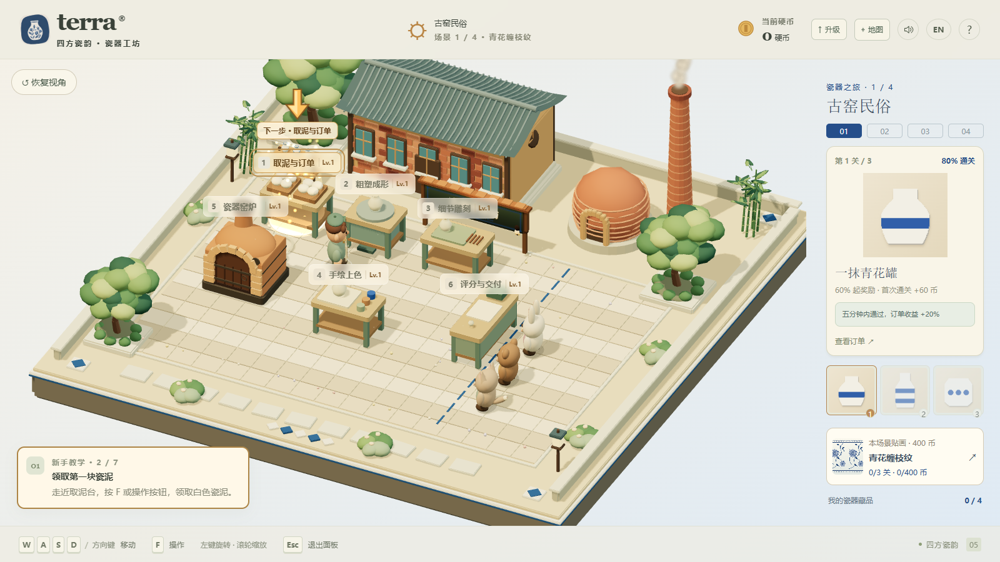
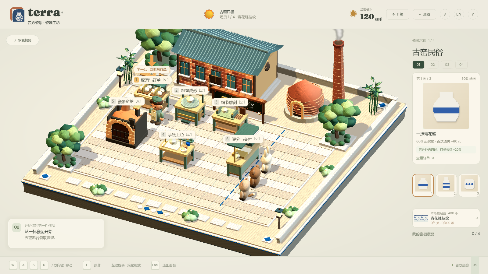
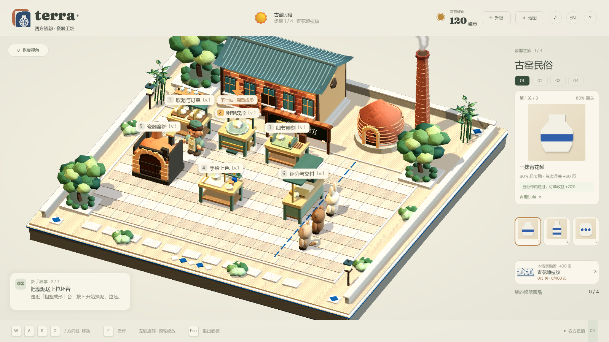
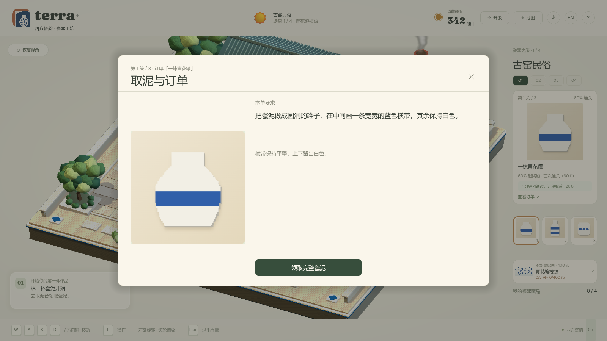
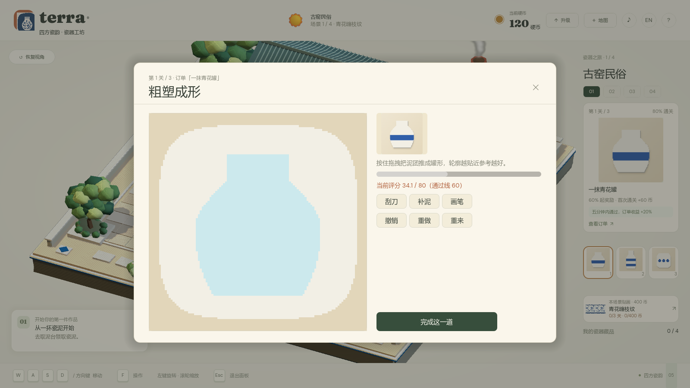
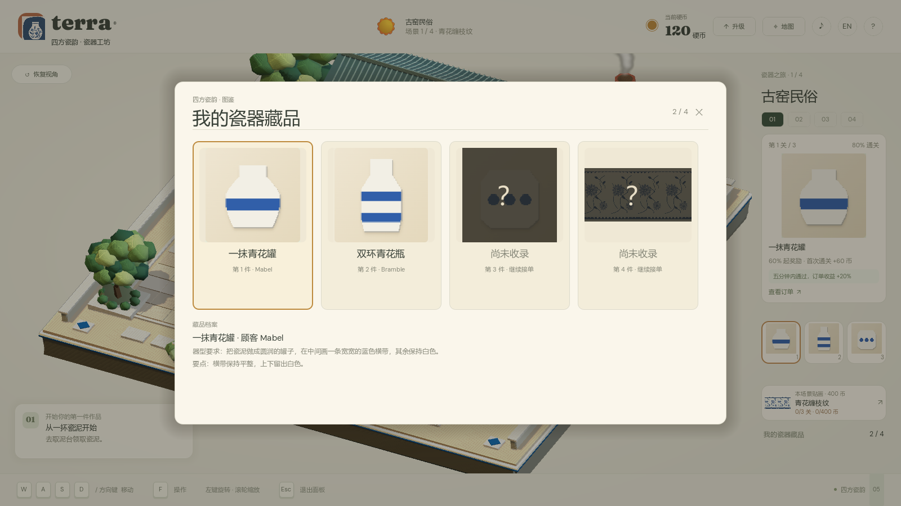

# 06 · 视觉与交互对齐流程（three.js → Godot）

目标是让 Godot 版的古窑一站与 `legacy/web-demo` 的 three.js 版 **几乎一致**：布局一致、镜头一致、面板位置与排版一致、同一串操作的状态迁移与文案一致。
本文记录「怎么量化这件事」，以及现有的基线数据。

## 1. 为什么要有基线

肉眼看两张图会漏两件事：**数值漂移**（相机距离差 0.3m、面板宽 12px）和**状态机漂移**（同样是「先雕刻再上色」，一边允许一边锁住）。
所以对齐工作分两条线，都落成可重复执行的脚本：

| 线 | 工具 | 产物 | 判定 |
| --- | --- | --- | --- |
| 像素 | `art/tools/legacy_probe.py` + `art/tools/compare_shots.py` | `.local/legacy-shots/*.png`、`.local/tmp/parity-report.json` | SSIM ≥ 0.92 且平均像素差 ≤ 6% |
| 数值/状态 | 同一支 probe 抓的 `art/data/legacy-*.json` + GDScript 单测 | 流程快照、DOM 计算样式、订单/评分字段 | 逐字段相等（浮点 1e-6） |

## 2. 抓 legacy 基线

前置：Playwright（`pip install playwright`）与本机 Edge（`channel="msedge"`，无需另下 Chromium）。
先起 dev server，再跑 probe：

```powershell
# 终端 A
node legacy/web-demo/node_modules/vite/bin/vite.js --host 127.0.0.1 --port 5199
# 终端 B
python art/tools/legacy_probe.py
```

产物：

- `.local/legacy-shots/` — 19 张全流程截图（开场两段、世界、取泥、订单、三个编辑器、窑炉、结算、旅程、升级、地图、帮助）
- `art/data/legacy-flow.json` — 每一步的 `state` 快照（scene/level/attempt/phase/money/hasClay/hasShape/hasPaint/fired/painted/canWork/canSubmit + 预设 + toast 文案）
- `art/data/legacy-screen-tokens.json` — 每个屏幕里 37 个选择器的 16 个计算样式属性 + `getBoundingClientRect` 盒模型
- `art/data/legacy-ui-tokens.json` — 最后一次采样的扁平表（便于 grep）
- `game/assets/reference/preset-*.png` — 订单参考器型图（也就是渲染评分对照用的那张图）

**开场有两段**：`.city-prologue` 是标题页，点 `#unfold-map` 才进入 `.opening-map-phase`，此时 `#start-button` 才可见。probe 已按这个顺序点击。
**教程门控**：`openStation()` 会先过 `tutorialGate()`；第一课是「移动」，必须真的走动（`world.stride` 增长）才推进。probe 用 5 次短按 WASD 完成，随后六台才逐个解锁。
**窑炉**：必须先点 `#fire-button`（`state.fire()`），再按住空格鼓风；probe 循环鼓风直到 `state.kilnResult` 出现，最后再点一次 `#fire-button`（此时文案是「完成 · 返回工坊」）才解锁交付台。

## 3. 抓 Godot 截图

Godot 侧统一用启动参数驱动，避免手点：

```
-- screen=<world|supply|brief|editor|kiln|review|result|...>   # 直接进入指定界面
-- shot=<绝对路径>                                             # 等 40 帧截图后退出
-- autoplay=<json>                                             # 重放一段操作序列（对齐 flow）
```

`Main.tscn` 已实现 `-- shot`，并额外支持 `bare`（隐藏 HUD/标签/提示）、`walkto=<站点id>`（脚本化走位）与 `clay`（直接进入「已取泥」里程碑）。`-- screen=<world|supply|brief|editor|carve|paint|kiln|review|result>` 已在 `Main.tscn` 实现，
`-- autoplay=<json> [-- autoplay-dir=<绝对目录>]` 也已实现：按 `art/data/legacy-flow.json`
逐条重放 hasClay/hasShape/hasPaint/fired/near，并输出 `<id>.png` 到指定目录。

然后：

```powershell
python art/tools/compare_shots.py --pairs 02-world:world,06-wheel:editor
python art/tools/compare_shots.py --crop 0,60,1330,760   # 只比 3D 区域，忽略右侧面板
```

比对结果写 `.local/tmp/parity-report.json`，并给每对图生成 `.local/tmp/diff/diff-<name>.png`（红=差异大）。

## 4. 阈值与已知噪声

- SSIM 用 8×8 均匀窗、亮度加权；一键把图整体压暗 10% 会让 SSIM 掉到约 0.65，所以 0.92 是严格阈值，够用。
- 3D 场景里有**时间相关内容**（烟雾、尘埃、树木摆动、角色待机），逐像素比较时建议 `--crop` 掉天空与树下区域，或接受 6% 的平均差。
- 字体：legacy 用 `Fraunces` / `DM Sans` / `ZCOOL KuaiLe`（OFL）。Godot 侧需下载同名 OFL 字体入 `game/assets/fonts/`，否则中英文行宽不同会让所有面板的换行位置变化，SSIM 直接掉到 0.8 以下。

## 5. P0 基线（历史）



- 19 张截图、19 组屏幕令牌、19 步 flow 快照，`errors: 0`。
- 世界层关键数值（来自 legacy 源码，已写入计划）：六个工作站世界坐标与尺寸见 `docs/01` 第 13 节；玩家速度 3.35 m/s、交互半径 1.04、出生点 `(-4.55, -2.15)`。
- 已知与当前 Godot 切片的差距：Godot 现在是 6 台工作台一字排开的简化场景，没有真实站点 GLB、没有玩家/顾客、没有站点标签与教程卡；面板是 504px 画布 + 右侧信息栏，legacy 是 940px 居中大面板（左侧画布 390px、右侧参考图与说明）。

三张关键基线图（`docs/images/`）：`legacy-world.png`（世界层 + 顶栏 + 右侧订单栏 + 教程卡 + 站点标签）、`legacy-wheel.png`（940px 编辑器大面板）、`legacy-kiln.png`（窑炉扇环与 12 秒计时）。


## 6. P2 世界层现状（2026-10-27）

`game/scenes/main/Main.tscn` 已从「6 台一字排开」升级为按 legacy 布局重建的完整世界层：



- **壳层**：顶栏（品牌、场景胶囊、钱包、升级/地图/音乐/语言/帮助）、右侧「瓷器之旅」订单栏（章节 chip、
  参考卡、3 个器型缩略图、贴画目标、藏品计数）、左下引导卡、底栏键位提示、左上「恢复视角」。
  全部由 `game/ui/site_hud.gd` 按 legacy CSS 盒模型用代码搭建，字体使用 OFL 的 DM Sans / Fraunces。
- **世界**：站点 GLB + 六台工作台 + 玩家（行走/待机/持泥）+ 三只顾客 + 站点标签；标签上方有
  「下一站 · 取泥与订单」奶白提示牌与橙色箭头（`game/ui/world_labels.gd`），随里程碑切换到下一站。
- **引导**：靠近站点显示「按 F 操作」卡（`game/ui/interaction_prompt.gd`），首次移动后才出现；
  引导卡按七个里程碑切换（取泥 → 拉坯 → 雕刻 → 上色 → 烧窑 → 交付）。
- **氛围**：烟囱烟雾（`ParticleField`）、站点光幕/粒子/地环、材质调色（`SiteWorld.PALETTE`）。



当前量化结果（`02-world-bare` 对 `world.png`，1600×900，全图）：

| 指标 | P2 前 | 现在 |
| --- | --- | --- |
| SSIM | 0.4691 | 0.4399 |
| 平均像素差 | 0.1489（14.9%） | 0.1450（14.5%） |

平均像素差下降、SSIM 略降，是两组指标的分工不同：调色让大面积色块更接近 legacy（平均差下降），
但 SSIM 对局部结构敏感，地面砖缝/树叶边缘与 legacy 的几何错位被更接近的明暗关系放大。
单独去掉地面砖缝调色可把 SSIM 拉回 0.4510，说明剩余差距主要在**相机/岛屿的逐像素对齐**与**砖缝几何**，
而不在色相；这也解释了为什么单靠曝光/饱和度无法把 SSIM 推过 0.92。

## 7. 站点面板接入（2026-10-27）

`Main.tscn` 现在按 F 打开站点面板，完整闭环已经跑在同一个场景里：
取泥 → 拉坯 → 雕刻 → 上色 → 烧窑 → 交付；三单交完后铜钱、图鉴与存档都会更新。





- 面板由 `game/ui/station_sheet.gd` 提供：奶白纸卡 + Fraunces 标题，内容区按站点切换；
  拉坯/雕刻/上色复用 `SculptCanvas` + `SculptSession`，窑炉复用 `HeatBar` + `KilnRun`。
- `SculptCanvas` 增加了 `background` / `empty_color` 两个主题钩子，才能从旧深色面板搬到纸卡上。
- `main.gd` 负责订单状态、七步引导文案、「下一站」高亮与交付结算；`SiteHud` 的参考卡会随订单
  更新器型图与「第 N 关」。
- `boot.gd` 的默认入口已从 `Workshop.tscn` 切到 `Main.tscn`；`Workshop.tscn` 保留为旧视觉切片 /
  回归场景，冒烟脚本改为检查 `SITE_OK`。

仍未完成：

- `-- autoplay=<json>` 已可用：默认输出到 json 同目录的 `godot-flow/`，目前只覆盖古窑一站的状态。
- 一日打烊已有整屏结算卡（`StationSheet.show_round`：成交单数、当日进账、铜钱总数、图鉴收录），
  但还没有 legacy 的逐件藏品陈列。
- i18n、音频、图鉴 UI 仍属 S1 的后续条目。

## 8. 图鉴面板（2026-10-27）



- 入口：右栏「我的瓷器藏品」一行可点，或按 `C`；`Esc` 或卡片右上角关闭。
- 四格：已收录显示器型图、名字与顾客，未收录留深色剪影与「？」；第四格用贴画纹样占位。
- 点击任一格在下方看藏品档案（器型要求 / 要点）；收录数同步右栏 `N / 4`。
- 数据只读 `catalog.json` 的 guyao 订单与 `SaveGame.data.codex.discovered`，交付时由 `GameState.discover()` 写入。
- 仍需补：跨站点图鉴、未收录条的获取线索、图鉴完成奖励。
